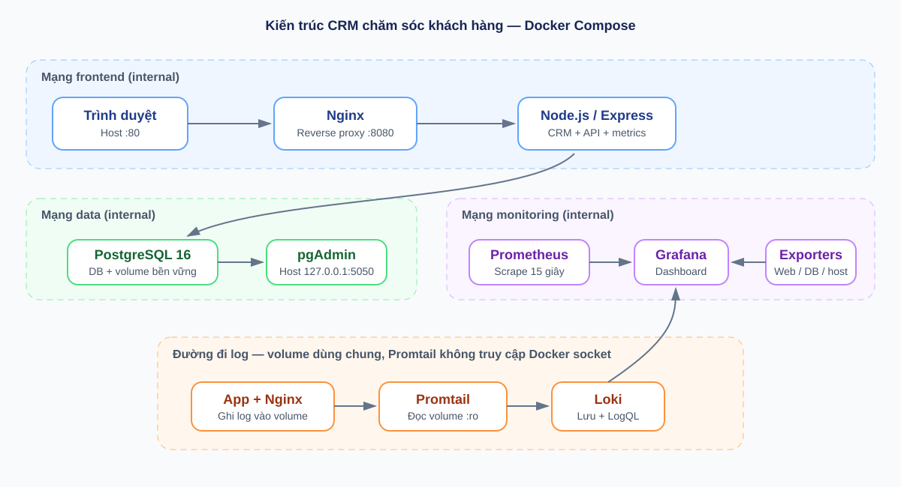

# CRM chăm sóc khách hàng — triển khai bằng Docker Compose

Ứng dụng CRM mẫu theo **Đề 4: Hệ thống CRM Chăm sóc Khách hàng**. Hệ thống gồm giao diện quản lý khách hàng, Node.js/Express, PostgreSQL, pgAdmin, Nginx reverse proxy, Prometheus, Grafana, cAdvisor, PostgreSQL/Nginx exporters, Loki và Promtail.

> Dự án là bản mẫu để học tập. Trước khi nộp, hãy thay thông tin sinh viên, đổi mọi mật khẩu, chạy thử trên máy dùng demo và bổ sung ảnh chụp màn hình thật vào báo cáo.

## Kiến trúc



Luồng truy cập: trình duyệt → Nginx (`:80`) → ứng dụng Express (`:3000`, chỉ nội bộ) → PostgreSQL (`:5432`, chỉ nội bộ). Docker network `edge` cho phép host truy cập các cổng được publish; các mạng `frontend`, `data` và `monitoring` vẫn được cô lập nội bộ để phân tách luồng east-west. Prometheus thu thập metrics từ ứng dụng, Nginx, PostgreSQL và cAdvisor; Grafana hiển thị dashboard. Ứng dụng và Nginx ghi log vào volume dùng chung với Promtail; Promtail chuyển log sang Loki. Không cần gắn Docker socket vào Promtail.

## Yêu cầu

- Docker Desktop (Windows/macOS) hoặc Docker Engine + Docker Compose v2 (Linux).
- RAM khuyến nghị 4 GB trở lên; các container được giới hạn tài nguyên ở mức phù hợp cho máy thực hành.
- Git để quản lý mã nguồn.

## Khởi chạy

Trong PowerShell, mở thư mục dự án rồi chạy:

```powershell
Copy-Item .env.example .env
```

Sửa `.env` bằng bốn mật khẩu ngẫu nhiên dài (khuyến nghị tối thiểu 24 ký tự), không dùng lại mật khẩu thật. `POSTGRES_USER` là tài khoản quản trị chỉ dùng khởi tạo/quản trị; ứng dụng và exporter kết nối bằng `APP_DB_USER`, chỉ có quyền CRUD trên bảng và quyền đọc metrics. Sau đó:

```powershell
docker compose config
docker compose up -d --build
docker compose ps
```

Ứng dụng tự tạo các bản ghi CRM mẫu trong lần khởi tạo PostgreSQL đầu tiên.

| Thành phần | URL | Tài khoản |
|---|---|---|
| CRM qua Nginx | http://localhost | Không yêu cầu đăng nhập (bản demo) |
| pgAdmin | http://localhost:5050 | `PGADMIN_DEFAULT_EMAIL` / `PGADMIN_DEFAULT_PASSWORD` trong `.env` |
| Grafana | http://localhost:3000 | `GRAFANA_ADMIN_USER` / `GRAFANA_ADMIN_PASSWORD` trong `.env` |
| Prometheus | http://localhost:9090 | Không có tài khoản; chỉ bind loopback |
| Loki API | http://localhost:3100 | Không có tài khoản; chỉ bind loopback |

### Kết nối pgAdmin tới PostgreSQL

Trong pgAdmin, chọn **Register → Server**:

- General → Name: `CRM local`
- Connection → Host name/address: `db`
- Port: `5432`
- Maintenance database: giá trị `POSTGRES_DB` (mặc định `crm`)
- Username: giá trị `POSTGRES_USER` (mặc định `crm_admin`)
- Password: giá trị `POSTGRES_PASSWORD`
- Bật **Save password** nếu cần cho buổi demo.

pgAdmin đăng nhập bằng tài khoản quản trị để có thể quản lý schema; ứng dụng và PostgreSQL exporter dùng tài khoản quyền hạn chế `APP_DB_USER` / `APP_DB_PASSWORD`. PostgreSQL không publish cổng ra máy host; pgAdmin truy cập DB qua network Docker nội bộ.

## Kiểm tra và demo

1. Mở CRM; tìm kiếm, lọc theo trạng thái, thêm khách hàng và xóa khách hàng. API có `GET/POST/PATCH/DELETE /api/customers`; ví dụ:

   ```powershell
   Invoke-RestMethod http://localhost/api/customers
   ```

2. Trong Grafana mở **Dashboards → CRM → CRM - System Overview**. Các panel dùng Prometheus cho request rate/latency, CPU/RAM container, session PostgreSQL và kết nối Nginx.
3. Mở **Explore → Loki** và thử LogQL:

   ```logql
   {job="crm-app"}
   {job="crm-app", type="http"}
   {job="nginx"}
   ```

   Chọn time range **Last 15 minutes**, chạy từng truy vấn riêng và gửi request tới CRM để phát sinh log. Nếu muốn tìm lỗi 5xx, có thể dùng `{job="nginx"} |~ " 5[0-9][0-9] "`; truy vấn này chỉ có kết quả khi Nginx thực sự ghi nhận response 5xx, nên rỗng khi hệ thống đang hoạt động bình thường. Chờ vài giây để Promtail chuyển log sang Loki.
4. Kiểm tra health và security headers:

   ```powershell
   Invoke-WebRequest -Method Head http://localhost
   Invoke-RestMethod http://localhost/health
   ```

5. Mở PowerShell, chuyển tới thư mục dự án rồi kiểm tra trạng thái các service:

   ```powershell
   cd "C:\Users\khacb\OneDrive\Desktop\triển khai"
   docker compose ps
   ```

   Kiểm tra cột `STATUS`: `Up` nghĩa là container đang chạy; `healthy` nghĩa là health check đã thành công. Xem 100 dòng log gần nhất của ứng dụng, Nginx và PostgreSQL:

   ```powershell
   docker compose logs --tail 100 app nginx db
   ```

   Muốn theo dõi log trực tiếp khi gửi request tới website, dùng:

   ```powershell
   docker compose logs -f app nginx db
   ```

   Nhấn `Ctrl+C` để dừng theo dõi log; thao tác này không dừng các container.

## Cấu hình, mạng và bảo mật

- Các bridge network tách luồng `edge` (cổng publish), `frontend`, `data`, `monitoring`; database không có cổng public, app và Nginx chỉ có endpoint cần thiết. Cổng quản trị/metrics chỉ bind loopback trên host.
- Ứng dụng chạy bằng user `node`, filesystem read-only, bỏ Linux capabilities, `no-new-privileges`, tmpfs riêng, giới hạn PID và CPU/RAM.
- Nginx chạy non-root trên cổng container 8080, filesystem read-only và có CSP, `X-Frame-Options`, `X-Content-Type-Options`, `Referrer-Policy`, tắt lộ phiên bản.
- API giới hạn kích thước JSON, validate dữ liệu và dùng truy vấn PostgreSQL tham số hóa. Ứng dụng dùng `APP_DB_USER` chỉ có quyền CRUD trên bảng và `pg_monitor`, không dùng superuser `POSTGRES_USER`.
- `.env` bị loại khỏi Git. Chỉ commit `.env.example`; không đưa mật khẩu thật vào repository.
- pgAdmin, Grafana, Prometheus và Loki chỉ bind vào `127.0.0.1` trên host. CRM demo hiện chưa có xác thực người dùng; không public ra Internet.
- Nginx hiện phục vụ HTTP kèm security headers (đáp ứng phương án headers cơ bản). Nếu triển khai Internet, cấu hình TLS với chứng chỉ hợp lệ, xác thực CRM, firewall và quản lý secret chuyên dụng.
- cAdvisor cần đọc một số đường dẫn hệ thống Docker để thu thập metrics. Hãy giới hạn quyền truy cập Docker host; bỏ service này nếu môi trường không cho phép mount các đường dẫn trên.

## Tắt và xóa dữ liệu demo

```powershell
docker compose down
```

Lệnh sau xóa cả database, dashboard và lịch sử metrics/log; chỉ dùng khi thật sự muốn reset:

```powershell
docker compose down -v
```

## GitHub và 3 commit yêu cầu

Đổi tên repository theo mã số sinh viên, ví dụ `20241234-crm-customer-care`, rồi tạo repository GitHub trống. Thứ tự commit nên thể hiện rõ từng mốc chấm:

1. `feat: deploy CRM database and Nginx reverse proxy` — source, DB, pgAdmin, Nginx và security headers.
2. `feat: add Prometheus and Grafana monitoring` — exporters, Prometheus scrape config, Grafana datasource/dashboard.
3. `feat: add Loki logging and system hardening` — Promtail/LogQL, Compose hardening, báo cáo, README và hình minh họa.

Sau khi tạo repository trên GitHub, thêm remote và push branch chính:

```powershell
git remote add origin https://github.com/<github-user>/<ma-so-sv>-crm-customer-care.git
git branch -M main
git push -u origin main
```

Repository hiện được tạo trong thư mục cục bộ; chưa có remote GitHub do cần tài khoản/owner repository của sinh viên.

## Báo cáo

Mở [report/bao-cao.html](report/bao-cao.html) trong trình duyệt, thay các trường `[ĐIỀN ...]`, kiểm tra phân trang rồi **Print → Save as PDF**. Báo cáo có 11 trang bố cục in A4, hình kiến trúc và sơ đồ luồng. Bổ sung ảnh chụp màn hình thật từ buổi demo vào các vị trí được chỉ rõ trong báo cáo.
